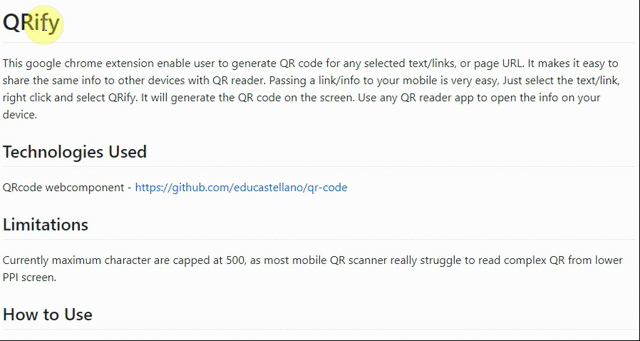

#  QRify
This google chrome extension enable user to generate QR code for any selected text/links, or page URL. It makes it easy to share the same info to other devices with QR reader. Passing a link/info to your mobile is very easy, Just select the text/link, right click and select QRify. It will generate the QR code on the screen. Use any QR reader app to open the info on your device.


## Technologies Used
QRcode webcomponent - [https://github.com/educastellano/qr-code](https://github.com/educastellano/qr-code)

## Browser Compatibility
QRify uses Manifest V3 for current Google Chrome. The background runs as an
event-driven service worker, and the toolbar popup uses the `action` API.
Right-click actions inject the bundled QR generator into the clicked tab's
isolated world, without loading scripts into the website or syncing selected
text through Chrome storage.

Only `contextMenus`, `activeTab`, and `scripting` permissions are required.
Chrome does not allow overlays on protected pages such as `chrome://` pages
and the Chrome Web Store. Use the toolbar popup to generate their URL instead.
An `ERR` badge and toolbar tooltip indicate when an overlay could not be shown.
For local files, enable **Allow access to file URLs** in the extension's details.

## Limitations
Text selections and edited popup input are capped at 500 characters. Long
selected links are shortened by removing trailing URL segments until they fit
600 characters, where possible. The page URL action uses the full URL. Most
mobile QR scanners struggle to read complex QR codes from lower PPI screens.

## How to Use
### This extension is now published to Chrome Webstore - [link](https://chrome.google.com/webstore/detail/qrify/nnokneneaanlmkpcibflacfhhneijagl).

#### Alternatively you can add it via **Developer Mode**:
   - Download and extract the current repository source, or clone this repository. The old v0.1.7 release still uses Manifest V2.
   - Go to `chrome://extensions`.
   - Enable Developer mode.
   - Select Load Unpacked --> Select the directory where you extracted the zip.
   - Enable the Extension if not enabled by default.
    
    
   
### Note
Chrome might ask you to disable the Extension on next session as this is using **Developer Mode**.

### Development checks
Run the dependency-free regression tests with Node.js 18 or later:

```sh
node --test tests/*.test.js
```

### Demo


